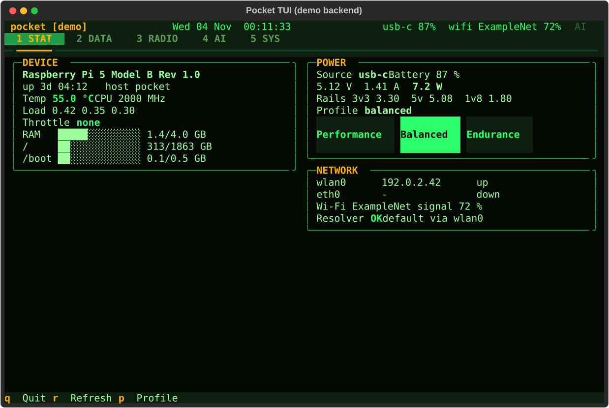

# Pocket Linux Computer

A go-bag Linux computer built around a Raspberry Pi 5. The goal is a real machine with a keyboard, a small
touchscreen, large storage, days of battery, an offline reference library and local language models, with
Claude Code running on the device so an AI can help manage it. This repository holds the software that
already runs on a Pi, the scripts that rebuild the device from a blank SD card, and an early enclosure design.



*The console-mode text UI, running against its built-in demo backend on a laptop.*

## Status

Stated plainly, as of November 2026:

**Works**
- The software ran on a real Pi 5 (4 GB, 64 GB microSD) on 2026-10-16: provisioning stages 10 and 30 to 80,
  the Blocky ad-blocking resolver (5 of 5 acceptance checks on home Wi-Fi), Claude Code with the MCP server,
  the text UI, a Kiwix library of 42 archives, and llama.cpp with a 1.5B model.
- `pocket_core` (device backend, `pocketctl` CLI, MCP server with 11 tools) and `pocket_tui` (Textual UI with
  five tabs) have automated tests that run on any machine against a fake backend: 79 and 12 tests. The
  79 include the allow-list checks for `pocket-helper`, the one program the device user may run as root.
- Measurements on the bare board: 1.8 to 2.3 W idle, thermal throttling after about 5 minutes of 4-core load
  without a cooler, and a phone-style charger that browns the board out under a full-speed model run. They are
  in [docs/01-hardware.md](docs/01-hardware.md).

**Does not exist yet**
- The hardware beyond the bare Pi: no display, battery, keyboard or case is built or wired. The NVMe and btrfs
  stage has not been run. The enclosure is a first OpenSCAD bench tray, not printed or tested.
- The provisioning scripts have run only on the SD card, and the arm64 container test has not been re-run
  since the last cleanup. Most design decisions are still marked "proposed".
- The snapshot safety net. The hooks that snapshot before risky commands do nothing until the root filesystem
  is btrfs, which only the NVMe runbook creates. On the stock ext4 install there are no snapshots.
- Ad blocking was checked on home Wi-Fi only, not over a phone tether or the hotspot. It is DNS filtering plus
  firewall rules for IPv4 resolvers, not a guarantee: DNS-over-HTTPS to other hosts, and to the listed
  resolvers over IPv6, is not blocked.

## Layout

```
core/            pocket_core: device backend (fake + Linux), the pocketctl CLI, the pocket-mcp MCP server
tui/             pocket_tui: the console-mode text UI (Textual, five tabs)
provision/       scripts that turn a fresh Raspberry Pi OS image into the device (idempotent stages)
flash-kit/       Windows scripts that write the OS image to the Pi's own microSD over USB, plus templates
cad/             OpenSCAD sources for the enclosure
docs/            the plan: vision, hardware, software, AI, privacy, enclosure, roadmap, decisions, research
tools/           a helper that finds the Pi on the local network
```

The decisions so far, each one open to change (see [docs/decisions/](docs/decisions/)):

| | Decision |
|---|---|
| Compute | Raspberry Pi 5, 4 GB (8 or 16 GB is a drop-in upgrade) |
| Storage | NVMe on a bottom-mount board, with the microSD kept as a rescue disk |
| Display | Official Raspberry Pi Touch Display 2 over DSI |
| Power | A USB-C PD power bank first; an integrated 21700 cell board later |
| OS | Raspberry Pi OS 64-bit, rebuilt from `provision/` (the Pi is a build artifact, the repository is the source of truth) |
| Modes | Console mode (full-screen text UI, low power) and desktop mode (Wayland, Firefox, VSCodium) |
| AI | Claude Code on the device, an MCP server for status and control, a btrfs snapshot before risky commands |
| Ads | Local DNS filter for most apps, a firewall redirect of port-53 traffic, uBlock Origin in the browser |
| Enclosure | 3D-printed, parametric (OpenSCAD), one core with swappable mounts |

## Requirements

- To run the software and its tests on a laptop: Python 3.11 or newer. Tested with Python 3.12 on Windows.
  Dependencies are `textual` 8.2 or newer and `mcp` 2.3 or newer (the version tested; 1.x fails with current pydantic).
- To run it on the device: a Raspberry Pi 5 with Raspberry Pi OS Trixie (Debian 13, arm64) and a 64 GB or
  larger microSD card.
- Optional: `shellcheck` for the scripts, Docker with arm64 emulation for the container test, OpenSCAD 2021.01
  or newer for the enclosure, a Windows PC with `rpiboot` and Raspberry Pi Imager for the flash kit.

## Build and run

On a laptop, with the fake backend (no Pi needed):

```bash
python -m venv .venv
.venv/bin/python -m pip install -e "core[dev]" -e "tui[dev]"     # .venv/Scripts/ on Windows
POCKET_BACKEND=fake .venv/bin/pocketctl status
.venv/bin/pocket-tui --demo
```

On a Pi, copy this repository to `~/pocket` and run the stages from `provision/`. Start with a dry run:

```bash
cd ~/pocket/provision
sudo DRY_RUN=1 ./run.sh 10 30
sudo ./run.sh 10 30 50 55
```

[provision/README.md](provision/README.md) lists the stages, and
[provision/runbooks/](provision/runbooks/) covers flashing a card and the first boot. Nothing site-specific
is stored in the repository: copy `flash-kit/user-data.example`, `flash-kit/network-config.example` and
`provision/config/etc/pocket/restic.env.example` and fill in your own values.

**Remote access.** Stage 10 sets `PasswordAuthentication no` for sshd before it can start, and enables sshd
only when the account already has an `authorized_keys` file. With no key it leaves SSH off and says so. The
firewall accepts port 22 (and mosh) on every interface, so SSH is key-only by design, not by firewall.

**Root access for the device user.** The only sudo rules the stages write name fixed commands (`pocket-mode`,
`systemctl reboot`, `systemctl poweroff`) and one validating helper, `pocket-helper`, for power profiles and
snapshots. There are no wildcard sudoers rules. See [core/README.md](core/README.md).

### Code that provisioning downloads

The stages fetch and run code from the internet. Most of it is pinned; some is not. Review these before you run
them on a device you care about:

| Item | Stage | Pinned? |
|---|---|---|
| Claude Code, from the official installer at `https://claude.ai/install.sh`, piped to `bash` | 50 | No. It installs whatever is current. |
| Blocky `v0.26.2` binary from the project's GitHub release | 30 | Yes: version and sha256, checked before install |
| llama.cpp, built from source from tag `b11683` of `ggml-org/llama.cpp` | 80 | Yes: a release tag (override with `POCKET_LLAMA_TAG`). A tag can in principle be moved; a commit hash would be stricter. |
| Qwen2.5-1.5B-Instruct GGUF model | 80 | Yes: sha256 |
| Offline library files (Kiwix ZIMs, models, PDFs, ebooks) | 70, 75 | Where the source publishes a checksum, the manifest has it; files marked `-` have none |
| VSCodium apt repository and its signing key, fetched from `gitlab.com/paulcarroty/vscodium-deb-rpm-repo` and `download.vscodium.com` | 40 | No. The key is not checked against a known fingerprint. |
| VSCodium extension `anthropic.claude-code`, from Open VSX | 40 | No. Latest version. |
| `yt-dlp`, installed with `pipx` | 40 | No. Latest on purpose, because old versions stop working. |
| uBlock Origin, force-installed by a Firefox policy from addons.mozilla.org (`latest.xpi`) | 40 | No. Latest, updated by Firefox. |
| Blocklists (OISD, HaGeZi), refreshed daily by Blocky | 30 | No. They change daily by design. |
| Python packages for `pocket_core` and `pocket_tui` (`pip install -e`) | 55 | Lower bounds only; pip resolves the newest compatible versions. |
| Debian and Raspberry Pi OS packages from their apt repositories | all | Whatever the repositories serve, verified by apt's own signatures. |

## Tests

```bash
.venv/bin/python -m pytest core/tests -q      # 79 tests (one needs symlinks), fake backend, no network, no Pi
.venv/bin/python -m pytest tui/tests -q       # 12 tests, headless Textual
cd provision && shellcheck -x -S warning run.sh lib.sh stages/*.sh test/container-test.sh \
  config/usr/local/bin/pocket-{audit,backup,mode,snapshot} config/home/.local/bin/llama-chat
```

The arm64 container test (`provision/test/container-test.sh`) runs the stages in a Debian 13 image. It is
slow under emulation and needs Docker.

## Data sources and terms

The repository contains no library, map or model files. The stages download them at run time:

- Offline library: Wikipedia, WikiMed, iFixit, Wikivoyage and others as ZIM files from Kiwix; PDFs from US
  government, Red Cross and Hesperian sites; Project Gutenberg and Standard Ebooks. Each source, its license
  and its exact URL are in [docs/research/trove.md](docs/research/trove.md).
- Language models: Qwen2.5-1.5B-Instruct (Apache-2.0) and others from Hugging Face; see
  [docs/research/local-ai.md](docs/research/local-ai.md).
- Ad-block lists: OISD and HaGeZi, downloaded by Blocky at run time under their own terms.
- Hesperian's free PDFs may be copied for non-commercial use, but not redistributed digitally. The scripts
  download them to the device only.

## Credits

Built on Raspberry Pi OS, Blocky, Kiwix, llama.cpp, Textual, the Model Context Protocol Python SDK and
OpenSCAD. Raspberry Pi is a trademark of Raspberry Pi Ltd; this
project is not affiliated with or endorsed by Raspberry Pi Ltd or Anthropic.

## License

MIT. See [LICENSE](LICENSE).
