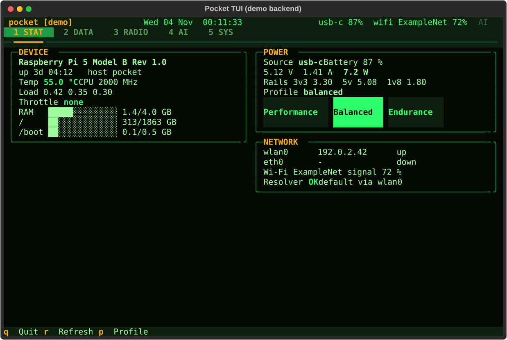

# Pocket TUI

The console-mode UI of the Pocket device: a [Textual](https://textual.textualize.io/) app in phosphor-green on
a dark background with amber warnings, driven by keys or touch. It renders in any terminal, so it works on the
display under `cage`/`foot` and over SSH from a phone.



Tabs (number keys switch, letters act, the footer lists what works on the current tab):

| Key | Tab | What is on it |
|---|---|---|
| 1 | STAT | temperature (green < 70 C, amber < 80 C, red above), throttle flags, load, RAM and disk bars, uptime; power (watts, rails, profile buttons: `p` cycles); interfaces, Wi-Fi, resolver OK/FAIL. Refreshes every 5 s off the UI thread; `r` refreshes now |
| 2 | DATA | search the offline library (`/` focuses the box, Enter searches, Enter on a hit opens it with `xdg-open`); notes in `~/notes` (`n` new timestamped note, `o` open in `$EDITOR`, default `nano`; the TUI suspends while the editor runs) |
| 3 | RADIO | Watch/Listen: a URL or search terms, `a` plays audio with `mpv --no-video` through `yt-dlp`, `v` plays video, `x` stops. SDR and Meshtastic are not built yet |
| 4 | AI | `c` runs `claude` (Claude Code CLI) in this terminal and resumes the TUI when it exits; `l` runs `~/.local/bin/llama-chat` if present; the tail of `~/.pocket/audit.log` |
| 5 | SYS | btrfs snapshots (`s` asks for a label), resolver on/off (`t`), brightness (`-`/`+`), `d` switches to desktop mode, `b` reboot and `h` power off behind a confirmation |

Header: hostname, clock, power source and battery, Wi-Fi signal, and an `AI` indicator that blinks while a
Claude session is running. Results of actions appear as toasts. `q` quits.

## Run the demo on any machine (no Pi needed)

```bash
python -m venv tui/.venv
tui/.venv/Scripts/python -m pip install -e "tui[dev]"      # bin/ instead of Scripts/ on POSIX
cd tui
.venv/Scripts/python -m pocket_tui --demo          # the full UI with fake, slowly changing data
.venv/Scripts/python -m pocket_tui --demo --once   # print one 80x24 frame and exit (smoke test)
.venv/Scripts/python -m pocket_tui --demo --once --size 160x45
.venv/Scripts/python -m pytest -q                  # 12 tests; or, from the repo root: pytest tui/tests -q
```

`--demo` uses the built-in fake backend (`pocket_tui/backend_fake.py`) and never starts external programs:
every command the TUI would run (`mpv`, `claude`, the editor, `sudo -n ...`) is written to the COMMAND LOG box
on the RADIO tab instead. Without `--demo`, it tries `pocket_core.backend.get_backend()` and falls back to the
fake (with a note on stderr and `[demo]` in the header) when that import fails, while still running real
commands.

## Install on the Pi

The TUI shares a venv with `pocket_core` (provision stage 55 does this):

```bash
python3 -m venv ~/.venvs/pocket
~/.venvs/pocket/bin/pip install -e ~/pocket/core -e ~/pocket/tui
~/.venvs/pocket/bin/pocket-tui            # real backend; add --demo to try it without hardware access
```

It needs, on the Pi: `mpv` and `yt-dlp` (stage 40), `claude` in `~/.local/bin` (stage 50), `nano` or `$EDITOR`,
`xdg-open` (xdg-utils) for library hits, and `sudo -n` rights for the SYS buttons, e.g. in
`/etc/sudoers.d/pocket-tui` (replace `<user>`):

```
<user> ALL=(root) NOPASSWD: /usr/local/bin/pocket-mode, /usr/bin/systemctl reboot, /usr/bin/systemctl poweroff
```

Without that line the buttons report `sudo: a password is required` instead of acting.

## How console mode launches it

`provision/config/etc/systemd/system/pocket-console.service` runs `cage` with `foot` on tty1. Stage 55 points
its `ExecStart` at the TUI inside a tmux session, so the UI survives the screen going off and a phone can
attach to the same session:

```
ExecStart=/usr/bin/cage -- /usr/bin/foot -f 'JetBrains Mono:size=14' -e tmux new -A -s pocket /home/@USER@/.venvs/pocket/bin/pocket-tui
```

From a phone: `mosh <user>@<host>`, then `tmux attach -t pocket`. `python -m pocket_tui` works in any terminal
that is at least 80x24; it lays out for 80x24 and for 160x45.

## Layout of this directory

```
pocket_tui/app.py           the Textual app: header, five tab panes, dialogs, every action
pocket_tui/pocket_tui.tcss  styling (colors come from the Theme in app.py)
pocket_tui/backend.py       the Backend protocol and the pocket_core / fake fallback
pocket_tui/backend_fake.py  deterministic demo data
pocket_tui/runner.py        starts external programs; dry-run mode records them instead
pocket_tui/__main__.py      `pocket-tui` / `python -m pocket_tui`, --demo, --once, --size
tests/test_app.py           headless pilot tests with the fake backend and a dry-run runner
docs/images/                SVG screenshots of the STAT and SYS tabs in demo mode
```
